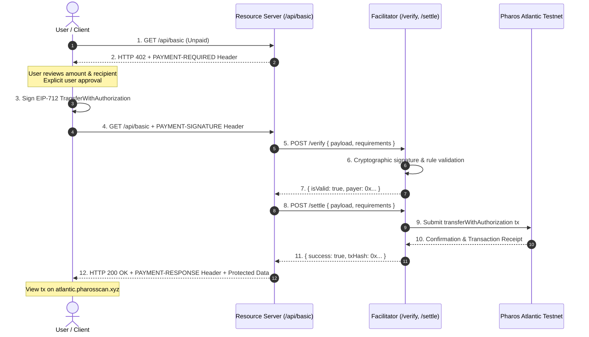

# Pharos x402 Paywalled API & Facilitator

> **Autonomous HTTP-Native Microtransactions on Pharos Atlantic Testnet**  
> Complete implementation of the Coinbase x402 payment protocol specification tailored for the high-performance Pharos EVM.

[](https://docs.pharos.xyz)
[](https://atlantic.pharosscan.xyz)
[-amber)](https://docs.pharos.xyz/getting-started/token-registry)
[](https://docs.pharos.xyz/developer-guide/x402)
[](LICENSE)

---

## ⚡ Quick Start: How to Test for Judges

Follow these 4 commands to immediately run and verify the entire payment lifecycle:

```bash
# 1. Clone and enter repository
git clone https://github.com/JimmyOgb/pharos-x402-paywalled-api.git
cd pharos-x402-paywalled-api

# 2. Install dependencies
npm install

# 3. Run the automated 16-point verification test suite
npm test

# 4. Start the interactive server & web dashboard
npm start
# Open http://localhost:4021 in your browser
```

Or run the automated client against the live server:
```bash
npm run client
```

---

## 📋 Table of Contents

- [Overview](#overview)
- [Architecture & Interaction Flow](#architecture--interaction-flow)
- [Endpoints & Differential Pricing](#endpoints--differential-pricing)
- [Pharos Atlantic Testnet Configuration](#pharos-atlantic-testnet-configuration)
- [How to Obtain Test Tokens (PROS & USDC)](#how-to-obtain-test-tokens-pros--usdc)
- [Facilitator Endpoints & Specification](#facilitator-endpoints--specification)
- [Security Model & Non-Custodial Rule](#security-model--non-custodial-rule)
- [Local Development & Manual Testing](#local-development--manual-testing)
- [Deployment on Vercel](#deployment-on-vercel)

---

## 🎯 Overview

The **Pharos x402 Paywalled API** provides autonomous machine-to-machine and user-to-service micropayments per API request. Using standard HTTP headers (`PAYMENT-REQUIRED`, `PAYMENT-SIGNATURE`, `PAYMENT-RESPONSE`), clients seamlessly receive payment requirements, request explicit authorization, sign cryptographic EIP-712 transfer authorizations, and settle on-chain on Pharos Atlantic Testnet before accessing protected data.

### Key Capabilities
- **Three Independently Testable Tiers**: 1 free endpoint (`/health`) and 2 differently priced paid endpoints (`/api/basic` at $0.001 and `/api/premium` at $0.005).
- **Embedded Independent Facilitator**: Full facilitator service exposing `GET /supported`, `POST /verify`, and `POST /settle`.
- **EIP-712 / EIP-3009 Standard**: Gasless payment signatures using `TransferWithAuthorization` on official Pharos test USDC.
- **Negative Rejection Enforcement**: Full rejection of underpaid, malformed, wrong-network, wrong-asset, or expired payloads with HTTP 402.
- **Zero Secret Exposure**: Strict non-custodial design adhering to Requirement 06.

---

## 🏛️ Architecture & Interaction Flow



---

## 💰 Endpoints & Differential Pricing

| Route | Access | Price (USD) | Price (Atomic Units) | Description |
|---|---|---|---|---|
| `GET /health` | **Free** | `$0.00` | `0` | System status & Atlantic Testnet connection check |
| `GET /api/basic` | **Paid** | `$0.001` | `1,000` (6 decimals) | Atlantic TPS, block height, validator metrics |
| `GET /api/premium` | **Paid** | `$0.005` | `5,000` (6 decimals) | Orderbook depth, slippage models, predictive alpha |
| `GET /api/config` | **Free** | `$0.00` | `0` | Public configuration & route pricing registry |

---

## ⛓️ Pharos Atlantic Testnet Configuration

| Parameter | Value | Source |
|---|---|---|
| **Chain Name** | Pharos Atlantic Testnet | [Pharos Docs](https://docs.pharos.xyz) |
| **Chain ID** | `688689` (`0xa8231`) | Official Network Specs |
| **CAIP-2 Identifier** | `eip155:688689` | x402 Specification |
| **RPC Endpoint** | `https://atlantic.dplabs-internal.com` | Official RPC |
| **Block Explorer** | `https://atlantic.pharosscan.xyz` | Official Explorer |
| **Verified Test USDC** | `0xcfC8330f4BCAB529c625D12781b1C19466A9Fc8B` | [Token Registry](https://docs.pharos.xyz/getting-started/token-registry) |
| **USDC Decimals** | `6` (1 USDC = 1,000,000 atomic units) | Token Contract Verification |
| **Permit2 Address** | `0x000000000022D473030F116dDEE9F6B43aC78BA3` | [Canonical Contracts](https://docs.pharos.xyz/getting-started/canonical-contracts) |

---

## 🚰 How to Obtain Test Tokens (PROS & USDC)

To test transactions on Pharos Atlantic Testnet:

1. **Native PROS (Gas)**:
   - Visit [Pharos Testnet Portal](https://testnet.pharosnetwork.xyz/) or [Pharos Port](https://port.pharos.xyz/get-pros) to claim testnet gas tokens.
   - Alternative community faucet: [ZAN Pharos Faucet](https://zan.top/faucet/pharos).
2. **Test USDC (Payment Asset)**:
   - Claim test USDC from [Zenith Swap Testnet Faucet](https://testnet.zenithswap.xyz/faucet).
   - Contract address for importing into MetaMask: `0xcfC8330f4BCAB529c625D12781b1C19466A9Fc8B`.

---

## 🛡️ Facilitator Endpoints

The service runs an autonomous facilitator conforming to the Pharos x402 core standard:

- **`GET /supported`**:
  Returns supported scheme (`exact`) and network (`eip155:688689`).
  ```bash
  curl http://localhost:4021/supported
  ```
- **`POST /verify`**:
  Validates cryptographic signature, network ID, recipient, token address, expiration, and non-underpaid amounts.
- **`POST /settle`**:
  Submits settlement to Pharos Atlantic Testnet and returns confirmed `txHash`.

---

## 🔒 Security Model & Non-Custodial Rule

- **Requirement 06 Strict Compliance**:
  - No private keys are hardcoded in source files, prompts, documentation, or git history.
  - `.env`, `.env.local`, and `.private_key` are git-ignored.
  - The browser dashboard uses local in-memory generation or explicit user wallet approval; keys are never transmitted.
  - Facilitator settlement keys (if configured) reside strictly on the server backend.

---

## 🧪 Local Testing & Verification

### 1. Test Free Endpoint
```bash
curl -i http://localhost:4021/health
# Returns HTTP 200 OK
```

### 2. Request Protected Endpoint Without Payment
```bash
curl -i http://localhost:4021/api/basic
# Returns HTTP 402 Payment Required with PAYMENT-REQUIRED header
```

### 3. Test Negative Rejection (Underpaid)
```bash
npm run client
# Automatically tests full flow, including rejection of underpaid authorizations
```

---

## 🌐 Deployment on Vercel

The application is structured for instant deployment to Vercel Serverless Functions:
1. Connect repository on [vercel.com](https://vercel.com).
2. All routes (`/health`, `/api/*`, `/verify`, `/settle`, `/supported`) route via `vercel.json` rewrite to `api/index.ts`.
3. Configure environment variables in Vercel project settings:
   - `PAY_TO_ADDRESS` (optional)
   - `FACILITATOR_PRIVATE_KEY` (optional)

---

## 📄 License

MIT License. Designed and built for Pharos Agent Arena Season of AI.
