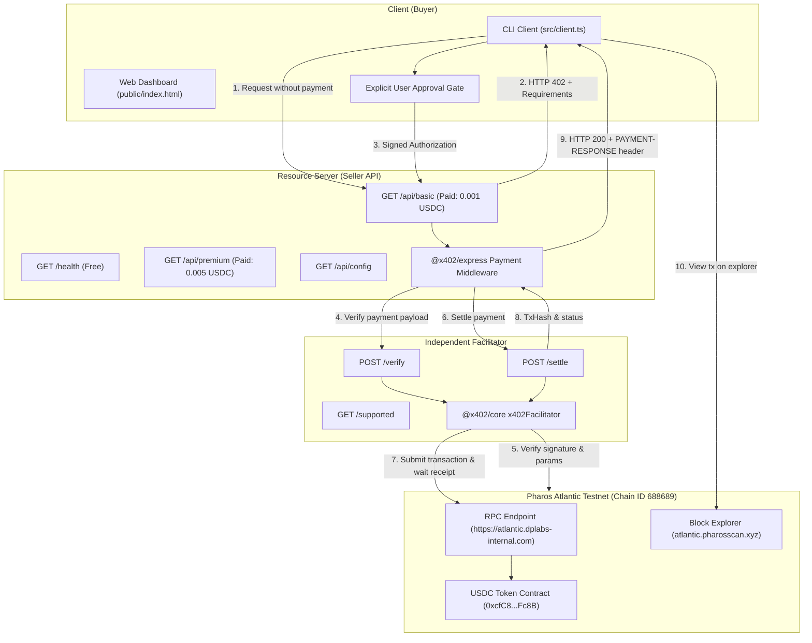

# Phase 2: Architecture & Implementation Plan — x402 Paywalled API

**Date:** November 8, 2026  
**Target Network:** Pharos Atlantic Testnet (`eip155:688689`)  
**Verified USDC:** `0xcfC8330f4BCAB529c625D12781b1C19466A9Fc8B` (6 Decimals)  
**Permit2 Contract:** `0x000000000022D473030F116dDEE9F6B43aC78BA3`  
**Explorer:** `https://atlantic.pharosscan.xyz`  

---

## 1. Component Architecture Overview

The system is decomposed into three independently testable components conforming to the official Pharos x402 specification:

---

## 2. Component Specifications

### A. Paid API Routes
- **`GET /health`**:
  - Access: Free ($0).
  - Response: `{ status: "ok", timestamp: string, network: "eip155:688689" }`.
- **`GET /api/basic`**:
  - Access: Paid.
  - Price: `0.001` USDC (`1000` base atomic units, 6 decimals).
  - Protected Resource: Basic analytics & network health indicators.
- **`GET /api/premium`**:
  - Access: Paid.
  - Price: `0.005` USDC (`5000` base atomic units, 6 decimals).
  - Protected Resource: Advanced predictive metrics & deep liquidity indicators.
- **Pricing Scheme & Precision**:
  - Scheme: `exact`.
  - Asset: `0xcfC8330f4BCAB529c625D12781b1C19466A9Fc8B`.
  - Decimals: `6`.
  - Network: `eip155:688689`.
  - Header on 402: `PAYMENT-REQUIRED` (includes complete payment requirements).
  - Header on 200: `PAYMENT-RESPONSE` (includes settlement tx hash and network info).

### B. Facilitator Endpoints
- **`GET /supported`**:
  - Returns supported protocol versions, schemes (`exact`), and network identifiers (`eip155:688689`).
- **`POST /verify`**:
  - Validates `paymentPayload` against `requirements`.
  - Enforces chain ID check (`688689`), token address match, recipient match, exact amount match, expiration, and cryptographic signature validity.
  - Rejects underpaid, malformed, or replayed payloads.
- **`POST /settle`**:
  - Submits the on-chain transfer authorization to Pharos Atlantic Testnet.
  - Awaits block confirmation and transaction receipt.
  - Returns settlement result with confirmed `txHash`.

### C. Client & User Control
- **Non-Custodial Explicit Approval**:
  - Payment authorization requires explicit human confirmation.
  - No secret keys in code, prompts, or frontend bundles.
  - Interactive web interface displays exact price, recipient, and transaction details before payment creation.
- **Negative Testing Capability**:
  - Allows submitting deliberately underpaid (e.g. 0.0005 USDC for a 0.001 USDC requirement) or invalidly signed payloads.
  - Verifies that HTTP 402 is returned and protected data is never exposed.

---

## 3. Serverless & Deployment Strategy (Vercel)

- Express application is structured with a handler function compatible with both local Node.js (`server.listen`) and Vercel Serverless Functions (`api/index.ts`).
- When running locally, server listens on `PORT` (default 4021).
- On Vercel, requests to all endpoints (`/health`, `/api/*`, `/verify`, `/settle`, `/supported`) are routed seamlessly through the serverless function.
